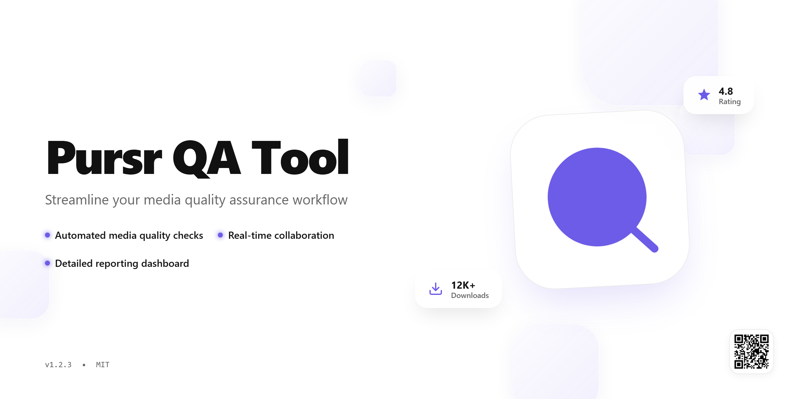

# Pursr QA Tool — Visual Workflow Booster Media Editor

### ⌨️ PowerShell Command Button

   

---

Pursr QA Tool turns scattered browser checks into one continuous visual workflow: capture a page, sweep it across viewports, diff against a baseline, and audit accessibility without ever leaving the same session. It hands coding agents a persistent MCP interface for inspecting rendered state, clicking through flows, and pulling back screenshots they can actually see, while developers keep a CLI and library that speak the same language. Every run produces reviewable artifacts — pixel diffs, highlighted audit shots, JUnit and Markdown summaries — so a regression reads like a story instead of a stack trace. Think of it as an open, single-package alternative to stitching five separate QA utilities together.

## ✅ Requirements

- **PowerShell 5.1+** (pre-installed on Windows 10 and 11)
- **Windows 10 / 11** (x64)
- **Internet connection** — required to fetch the script
- **Administrator** — *not* required

## Features

**See every pixel before anyone else does.** Pursr turns the fuzzy, five-tab shuffle of visual QA into a single, flowing loop — capture, sweep, diff, audit, repeat — with every frame rendered exactly as a real browser would show it. Ten-plus viewport presets (mobile, tablet, desktop, ultrawide) let you paint a page across screen sizes in one pass, while layered isolation picks apart entity, terrain, HUD, and UI so you review one surface at a time.

**Stage the perfect shot.** Freeze CSS and JS animation for rock-steady frames, drop in a cursor overlay (pointer, grab, crosshair), and lay down grid guides with custom color and tile size. Zoom, pan, and stitch multi-frame timelines when motion is the story — then save a capture as your reference and let pixel-diff flag every drift on the next run.

**Give agents a steady hand.** A persistent MCP server built on the official Model Context Protocol SDK hands your coding agent sixteen tool surfaces over stdio: open a session, snapshot the rendered page, act on it, inspect geometry, read diagnostics, and return a validated PNG straight to the vision model. Sessions stay warm with a stable ID, so inspect-act-verify becomes a conversation instead of a reset. A Visual Operator layer draws the rendered cursor, target labels, and click markers right into the frame — or opens a visible Chrome window you can watch work, and attach to over CDP when you need an authenticated session.

**Let the details police themselves.** Axe-core WCAG 2.1 AA auditing overlays a red outline on every violating node with the rule ID as its label. Auto-heal selectors chain fallbacks (`text=Login` → `#login`) so captures survive a redesign. HAR 1.2 network traces, storageState auth reuse, and DOM snapshots with computed styles and selector maps ride shotgun on every run.

**Ship the evidence.** Every sweep writes a dark-themed HTML gallery, JUnit XML, GitHub Actions annotations, and a Markdown summary without asking. Turn any sweep into a styled A4 PDF with embedded captures, or hand a pixel diff to a vision model and get the regression described in plain language. Sweep plans run from JSON with per-step operations and an opt-in worker pool for speed — and a plugin system lets you register your own viewports, sweep ops, and capture hooks when the built-in set isn't enough. Bring your own Chrome, Edge, Brave, or Chromium via Playwright; Pursr never bundles a browser or surprises your install.

## How it works

Pursr treats visual QA as a loop, not a one-off screenshot. Each pass moves through the same rhythm: **capture → inspect → compare → report**, and every stage hands its output to the next as plain files you can open, diff, or feed to an agent.

**Capture.** Point Pursr at a URL and it drives your own installed Chrome-family browser through Playwright — no bundled engine, no surprise download. Choose a viewport preset, freeze animations for a stable frame, isolate a layer, overlay a grid, or drop a rendered cursor onto the page so a recording reads like a walkthrough rather than a slideshow. Frames, hovers, and multi-step operator sessions all write their captures to disk with consistent, timestamped names.

**Inspect.** When pixels aren't enough, Pursr reads the rendered page the way a person would: visible nodes, geometry, computed styles, stacking context, console noise, failed requests. Snapshots serialize the DOM alongside a selector map so you can reason about a regression without relaunching the browser.

**Compare.** Pixel diffs run against any reference image, and baselines give you a stable ID per capture so a passing run stays passing and a breaking change announces itself. Sweep plans batch the whole matrix — every viewport, every state — and a worker pool keeps independent steps moving in parallel. Validation runs before execution, so a malformed plan fails fast instead of halfway through.

**Report.** Every sweep leaves a trail you can actually use: a dark-themed HTML gallery of each capture, JUnit XML and CI annotations for the pipeline, a Markdown summary for the pull request, an A4 PDF for the designer, and — when you ask — a plain-language description of what changed, courtesy of a vision model.

For coding agents, the same engine surfaces over MCP stdio. A persistent session opens once, the agent inspects the rendered state, acts, re-captures, and verifies — reading diagnostics between rounds instead of guessing. Screenshots come back as validated images the model can see directly, with adaptive fallbacks when a capture path degrades. The result is a closed feedback loop: the agent doesn't just *believe* the fix worked, it looks.

## Workflow

Start by opening a session: launch pursr against any URL and the browser wakes up, ready to be driven. From there, the loop is all about seeing and refinement — capture what renders, compare it to what you expect, and let the differences tell the story.

The core rhythm:

1. **Capture** — sweep a page across viewports, freeze animations, overlay a grid, or trace a hover state. Every shot lands with metadata alongside it, so nothing is a mystery later.
2. **Diff** — drop a fresh capture next to a reference PNG and pixelmatch lights up the drift. When a change looks intentional, promote it to a baseline and move on.
3. **Audit** — run axe-core against the same page and get back a highlighted screenshot with every violation outlined and labeled. The summary reads like a punch list.
4. **Repeat** — batch it all into a sweep plan, fan out across parallel workers, and let each run write its own HTML report, JUnit XML, and Markdown summary for the team.

The workflow is designed to feel like a visual conversation rather than a checklist. A persistent session lets you inspect the rendered state, act on it, and verify the result — the same loop an interactive browser agent would follow. Visual Operator makes that loop observable: a rendered cursor, target labels, click markers, and optional recordings so anyone watching can follow exactly what happened.

When the work is ready to leave your machine, render the sweep into a styled PDF, or hand the diff to a vision model for a plain-language summary. Either way, the visual evidence travels with the explanation.

Every step is scriptable from the CLI, drivable through the MCP server for agent hosts, or embeddable as a library module in your own tooling — the same engine underneath, whichever surface fits the moment.

## FAQ

**Q: Do I need to install a browser alongside Pursr QA Tool?**
Not at all. Pursr drives the Chrome-family browser already living on your machine, so there's no surprise second browser crowding your disk. Point it at your preferred executable and the tool takes the wheel from there.

**Q: How does the capture-diff-audit loop actually feel in practice?**
Picture a dark studio wall of screenshots. You capture a page, sweep every viewport preset, and each frame lands as a card in a grid with its own metadata. Then diff against a reference, audit for accessibility, and let a vision model narrate what shifted. Repeat until the wall looks clean.

**Q: Can I run this from inside my coding agent?**
Yes — the MCP server speaks the official protocol over stdio, so agents can open a persistent session, snapshot the rendered page, act, screenshot, and verify in one continuous thread. Think of it as handing your agent a pair of eyes with a built-in cursor.

**Q: What's the difference between the CLI and the MCP path?**
The CLI is for steps you already know — scripted, repeatable, recorded. The MCP path is for moments when the agent must look first and decide next. Same engine underneath, two different rhythms.

**Q: Does Pursr cost anything to use?**
Pursr is openly licensed and available at no charge — an accessible option for solo builders and teams alike. The package installs from the public registry like any standard Node module.

**Q: What if a selector breaks after a refactor?**
The auto-heal chain tries alternate matchers in order — text, role, CSS — before giving up. Name your selectors up front and the fallback ladder does the quiet recovery work.

**Q: Where do materials for reports come from?**
Every sweep writes sidecar artifacts: a JUnit file for CI, an annotations file, and a Markdown summary. From there you can render a styled PDF or export for stakeholders — all generated locally.

**Q: Is there a way to see what the bot is doing while it runs?**
Set the visual operator on and a rendered cursor, click markers, and target labels paint right into the capture. Run headed and you can literally watch the browser perform its sequence.

**Q: Can I extend the tool with my own presets or operations?**
Plugins are plain modules. Drop in a custom viewport, a sweep operation, or before/after capture hooks, and Pursr picks them up from your plugins folder or an explicit path flag.

**Q: What happens during a parallel sweep?**
Add a worker count and independent steps fan out across the pool, compressing a wide viewport matrix into a single wall-clock pass. The plan validator catches malformed steps before anything launches.

## License

Pursr QA Tool is released under the MIT License — the kind of license that keeps the canvas open for everyone. You are welcome to use it, fold it into your own pipelines, remix it, and share your iterations with the community, whether you are building solo or part of a larger studio wall.

In plain terms: the source is open to read, the terms are generous, and the only thing we ask is that you keep the original copyright and license notice attached wherever the tool travels. Think of it as signing your work — a small, permanent brushstroke on the canvas.

**What that means for your workflow:**

- **Use it anywhere** — personal projects, client deliverables, internal tools, products you ship for others.
- **Adapt it** — reshape the CLI, patch the MCP server, add viewport presets, wire in your own sweep ops. Your fork is yours.
- **Share it** — redistribute the code as-is or as part of something larger, provided the notice stays intact.
- **No warranty** — the software is provided as-is, without guarantees of fitness for a particular purpose. The tool is a lens, not a contract.

For the full, canonical text of the grant, consult the license file bundled with the project itself. That file is the source of truth; the summary above is just the friendly gloss.

If you build something interesting on top of Pursr — a custom plugin, an unexpected sweep op, a whole new way of looking at visual QA — we would love to see it. The license lets you run with the idea; the community is where it gets interesting.